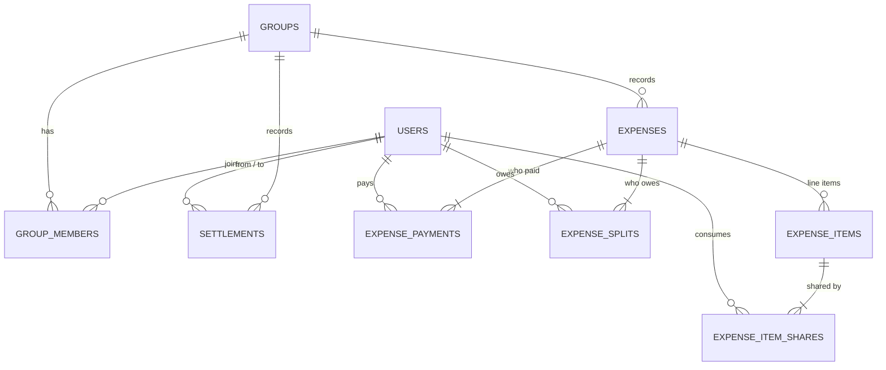

# Expense Sharing Service

A backend service (with a small web UI) that helps a group of friends track shared expenses and work out **who owes whom**. It's built with Django + Django REST Framework, SQLite and React.

Beyond the required features, it supports **item-level splits** (a dish or a hotel room shared by only some people), **bills paid by more than one person**, a simple **login**, and an **AI expense assistant**: describe an expense in a chat, 📷 scan a bill, or 🎤 speak, then review the draft and confirm.

🎬 **Demo video:** [Expense_sharing_demo.mp4](Expense_sharing_demo.mp4) (16 MB; on GitHub, click *View raw* to play or download it)

---

## Quick start (for evaluators)

You only need **Docker Desktop**, running.

```bash
docker compose up --build        # the first build takes a few minutes (it downloads the OCR models)
```

Then open **http://localhost:3000** and log in as **`Mohit` / `demo1234`**. Demo data and an admin login are created on the first start.

| What | URL | Login |
|---|---|---|
| Web app (mobile-friendly) | http://localhost:3000 | `Mohit` / `demo1234` (also `Rahul`, `Ankit`, `Priya`) |
| API docs (Swagger) | http://localhost:8000/api/docs | the core API needs none; for the AI endpoints, get a token from `POST /api/auth/login` and click **Authorize** |
| Admin panel (every table) | http://localhost:8000/admin/ | `admin` / `admin1234` |

**Demo data** (`python manage.py seed` runs on every start, but only fills an empty database):
- **Goa Trip** (group 1) is the assignment's example: Mohit paid ₹1200 for dinner with Rahul and Ankit. `GET /api/groups/1/balances` returns exactly the [example below](#the-assignments-example).
- **Mumbai Weekend** (group 2) shows the extras: an item-split lunch, a hotel paid by two people, a cab shared by three of the four, and a ₹1000 settlement. Tap **⬇ PDF** for the report.

### Turn on the AI assistant (optional, free, about 2 minutes)

Everything except the **✦ AI** tab works without this.

1. Open **https://console.groq.com/keys** and sign in (Google, GitHub or email). The free plan is enough.
2. Click **Create API Key**, give it any name, and copy the key. It starts with `gsk_` and is shown only once.
3. Create `backend/.env` from the example and paste the key into it:
   ```bash
   cp backend/.env.example backend/.env     # works in bash and PowerShell
   ```
   ```
   GROQ_API_KEY=gsk_your_key_here
   ```
4. Start (or restart) the app: `docker compose up -d --force-recreate`

**Try it in Goa Trip → ✦ AI.** Type or 🎤 say:
- *"I paid 900 for the cab with Rahul"*: an equal split between two people.
- *"Dinner 1500, I paid a thousand and Ankit paid the rest"*: two payers; Django works out "the rest" (500).

**Sample bills for the 📷 button** are in [`test-images/`](test-images/). On a computer, 📷 opens a file picker. The correct items for each bill are in `test-images/ground_truth.json`.

| File | What you should see |
|---|---|
| `img_6402.webp` (Hotel Deluxe, Mumbai) | **4 items, ₹1330.** Tap who had what: Butter Milk → Ankit; Veg Lunch → Mohit, Rahul; Karimeen → all three; Kallumakai → Rahul. Then tap Rahul under *Paid by*. Shares: **Ankit 216.66, Mohit 306.67, Rahul 806.67**. You can also type the answers, e.g. *"butter milk Ankit, veg lunch me and Rahul, karimeen everyone, kallumakai Rahul"*. |
| `22350881949_6b34e1c2a1_b.jpg` (restaurant) | **12 items, subtotal 2655.00.** The 237.05 service charge becomes a *Tax & charges* item, shared by everyone on the bill (total 2892.05). Try *"everyone had everything except the beef burger, that was only Rahul"*. |
| `Hotel-Receipt.png` (hotel folio) | **4 items + 12.5% tax = 780.75.** The tricky line is "3 x ROOM @ $189.00" (= 567). If an item is read wrong, the subtotal check catches it and asks you to fix it. |

Item names may come out slightly different (OCR), but the amounts should match.

### Useful commands

```bash
docker compose run --rm api pytest                           # run the tests with coverage
docker compose exec api python manage.py flush --noinput     # empty the database (then: ... manage.py seed)
docker compose down -v                                       # stop and delete all data
```

## Run locally (without Docker)

Backend (Python 3.13):
```bash
cd backend
python -m venv .venv
.venv\Scripts\activate            # macOS/Linux: source .venv/bin/activate
pip install -r requirements.txt
python manage.py migrate
python manage.py seed             # demo data + admin login (see the table above)
python manage.py runserver        # http://127.0.0.1:8000/api/docs
pytest                            # tests + coverage report
```

Frontend (Node 22), in a second terminal:
```bash
cd frontend
npm install
npm run dev                       # http://localhost:5173 (API calls are proxied to Django)
```

---

## Features

**Required**
- Create and list users
- Create groups, add members, list members
- Record expenses and view a group's expense history
- Split expenses equally among group members
- Calculate who owes whom across many expenses
- Record settlements (repayments) that reduce outstanding balances
- Validate amounts, group membership, payers and expense data

**Beyond the requirements**
- **Item-level splits:** one bill with items shared by different people (e.g. the pizza for 2, the beer for 1)
- **Multiple payers:** a bill paid with two cards
- **Choose participants:** split equally among only some members
- **AI expense assistant:** chat, receipt scanning (local OCR) and voice input; the AI fills a draft, you confirm (see below)
- **PDF export:** a group's balances, who pays whom, expense history and settlements in one file
- **Login:** sign up with a name and password; the assistant knows who "I" is
- **Web UI:** a mobile-first React app for every feature above
- **Swagger UI** and an **admin panel** for exploring the data, and a **seed command** with demo data

## The assignment's example

The demo data already holds it as group 1 (with an empty database, send this request first):
```http
POST /api/groups/1/expenses
{"description": "Dinner", "amount": "1200", "payers": [{"user_id": 1, "amount": "1200"}]}
```
```http
GET /api/groups/1/balances
{
  "members": [
    {"user_id": 1, "name": "Mohit", "paid": "1200.00", "share": "400.00", "net": "800.00"},
    {"user_id": 2, "name": "Rahul", "paid": "0.00", "share": "400.00", "net": "-400.00"},
    {"user_id": 3, "name": "Ankit", "paid": "0.00", "share": "400.00", "net": "-400.00"}
  ],
  "owes": {
    "Rahul": {"owes": {"Mohit": "400.00"}},
    "Ankit": {"owes": {"Mohit": "400.00"}}
  }
}
```
After `POST /api/groups/1/settlements {"from_user_id": 2, "to_user_id": 1, "amount": "400"}`, Rahul no longer owes anything.

---

## Architecture

```
React app (frontend/) ──HTTP/JSON──> Django REST API (backend/) ──ORM──> SQLite

backend/ledger/
├── models.py        9 tables
├── money.py         pure maths, no database: rupees · split_equally · who_owes_whom
├── services.py      database work: create_expense · calculate_balances
├── serializers.py   checks input (…Input classes) and shapes output (…Serializer classes)
├── views.py         the endpoints
├── urls.py          the routes
├── auth.py          sign up / log in (authentication.py: the signed token)
├── pdf.py           the group report as a PDF (ReportLab)
├── management/commands/seed.py   demo data and the admin login
└── tests/

backend/assistant/   the AI expense assistant
├── llm.py           one Groq call: message -> strict JSON
├── draft.py         plain functions: merge the JSON into the draft, choose the next question, do the maths
├── ocr.py           receipt photo -> text (RapidOCR, runs locally)
├── stt.py           voice -> text (Whisper on Groq)
├── views.py         the endpoints
└── tests/
```

Every POST follows the same four steps:
1. The view finds the group (404 if it doesn't exist).
2. An input serializer validates the JSON and the business rules (400 with a clear message).
3. A service saves the rows inside one transaction.
4. An output serializer returns the result.

In Docker, nginx serves the React app and forwards `/api`, `/admin` and `/static` to Django (gunicorn), so the UI and API share one origin and no CORS setup is needed.

---

## Database design

Full explanation, with three worked scenarios: [docs/db.md](docs/db.md)



The key ideas:
- **Who paid and who consumed are separate tables** (`expense_payments` and `expense_splits`). That makes multiple payers and any split strategy work with the same balance code.
- **Balances are never stored.** They're calculated from the expenses, payments, splits and settlements with four `GROUP BY` queries, so they can't drift out of sync.
- **Item splits roll up into `expense_splits`.** The balance calculation doesn't need to know how an expense was split.
- **Money is stored as whole paise** (`120050` = ₹1200.50), so every sum is exact. ₹100 split 3 ways is 33.34 + 33.33 + 33.33.
- **The database enforces what it can:** CHECK (amount > 0, no self-settlement), UNIQUE (no duplicate members or names) and PROTECT (financial history can't be cascaded away).

## API

Full reference with request and response examples: [docs/api.md](docs/api.md). It's also live at `/api/docs`.

| Method & path | Purpose |
|---|---|
| `POST/GET /api/users` | create / list users |
| `POST/GET /api/groups`, `GET /api/groups/{id}` | create / list / get groups |
| `POST/GET /api/groups/{id}/members` | add / list members |
| `POST/GET /api/groups/{id}/expenses` | add an expense / history |
| `GET /api/groups/{id}/balances` | who owes whom |
| `POST/GET /api/groups/{id}/settlements` | record a repayment / history |
| `GET /api/groups/{id}/pdf` | download the group report as a PDF |
| `POST /api/auth/signup`, `POST /api/auth/login`, `GET /api/auth/me` | login |
| `POST /api/groups/{id}/assistant` | one chat turn with the AI assistant (login required) |
| `POST /api/assistant/scan`, `POST /api/groups/{id}/assistant/transcribe` | bill photo -> text, voice -> text (login required) |

**Postman:** *Import → Link →* `http://localhost:8000/api/schema` builds a collection of every endpoint from the OpenAPI schema.

**How this maps to the assignment's suggested API** (the assignment allows a different design if it's justified):

| Assignment | This API | Why |
|---|---|---|
| `POST /expenses` `{"group_id": 1, "paid_by": 1, "amount": 1200, "description": "Dinner"}` | `POST /api/groups/1/expenses` `{"description": "Dinner", "amount": 1200, "payers": [{"user_id": 1, "amount": 1200}]}` | The group is in the URL, as it is for members. `payers` is a list, so two people can pay one bill. The assignment's body gets a 400 that names the missing `payers` field. |
| History item `{"description": "Dinner", "amount": 1200, "paid_by": "Mohit"}` | `{"description": "Dinner", "amount": "1200.00", "payers": [{"user_id": 1, "name": "Mohit", "amount": "1200.00"}], "splits": [...], "items": [...]}` | Same reason as above. The history also shows each person's share. |
| `GET /balances` → `{"Rahul": {"owes": {"Mohit": 400}}, ...}` | `GET /api/groups/1/balances` → the same shape under `"owes"`, plus each member's paid / share / net under `"members"` | Balances belong to one group. The extra numbers answer "how much each person spent / owes" from the assignment's overview. |
| `expenses.paid_by` column | `expense_payments` table | Multiple payers ([database design](#database-design)). |
| Bonus unequal split `{"amount": 1000, "splits": [{"user_id": 1, "amount": 500}, ...]}` | An item split with one item per person: `{"name": "Mohit", "amount": 500, "shared_by": [1]}`, … | One mechanism covers both "who had which dish" and exact amounts. |

---

## Design decisions

| Decision | Why |
|---|---|
| Django + DRF | migrations, transactions, an admin panel and test-database isolation built in; serializers keep validation declarative |
| SQLite | zero setup for reviewers; the ORM keeps the code portable to PostgreSQL (configuration only, no model changes); writes use `IMMEDIATE` transactions so concurrent writers wait instead of failing |
| Integer paise | exact arithmetic and explicit rounding (`divmod`); the leftover paisa goes to the lowest user id, so results are deterministic |
| Net balances + `who_owes_whom` | net positions work for any mix of payers, items and settlements; the payments list is derived from them (at most n−1 payments) |
| Nested routes (`/groups/{id}/...`) | expenses, balances and settlements always belong to one group |
| Money as strings in JSON (`"400.00"`) | avoids floating-point errors in JavaScript clients |
| Settlement capped at the outstanding amount | over-paying would silently create a new debt in the other direction, which is almost always a typo |
| PDF with ReportLab | pure Python, so the Docker image needs no system libraries (WeasyPrint would); its built-in fonts have no ₹ sign, so the PDF prints "Rs" |
| Demo data on every start | `seed` only fills an empty database: an evaluator can log in straight away, and a restart never duplicates anything |

## Product enhancement: AI expense assistant

**Why this feature (the problem it solves):** adding an expense by hand means typing amounts, picking payers and ticking names. On a trip, people just want to say *"I paid 1200 for dinner"* or snap the bill.

**What it does:** a chat tab inside each group. Type, 📷 scan a bill or 🎤 speak. The assistant asks only for what's still missing, in a fixed order (**items → who had what → who paid → title**). **The draft is shown at every step:** right after a scan you see the items, and you can answer each question by typing, speaking or **tapping names in the draft**. A tap needs no AI call: the draft goes back to Django with an empty message, which re-checks it and returns the next question. When nothing is missing, the card shows each person's share. **Nothing is saved until you tap Confirm** (or Edit, which opens the normal expense form, pre-filled).

**Design decisions:**
- **The LLM only extracts; Django decides.** One Groq call (`openai/gpt-oss-20b`, temperature 0, medium reasoning, **strict JSON schema**) turns a message into fields. Plain Python functions (`draft.py`) merge them into a draft, pick the next question and do all the maths. The LLM never calculates: it writes "a thousand" as `1000`, and "Ankit paid the rest" as `rest`, which Django turns into total − what the others paid.
- **People can't be invented:** the schema allows only the group's member names (plus "everyone").
- **One path for every input:** a scanned bill (RapidOCR, runs locally, the photo never leaves the server) and a voice note (Whisper on Groq, given the group's names so it spells "Ankit" right) both become text, and go through the same chat turn. OCR misreadings in item names ("UEG LUNCH") are corrected by the model; amounts never are.
- **Same rules as the form:** a finished draft has the shape of an expense request, so it's validated by the same `ExpenseInput` and saved by the same `POST /expenses`.
- **Receipts are checked, not trusted:** if the items don't add up to the printed subtotal, the model gets one second look (it's told the numbers); if they still don't match, the assistant asks you to fix them. The difference between items and total (tax, service charge) becomes a "Tax & charges" item. Who paid and who had what are never taken from a receipt.
- **Stateless:** the browser keeps the draft and sends it back each turn, so there are no new tables.

**Measured on 3 real receipts ([`test-images/`](test-images/)) and 4 chats** (`openai/gpt-oss-20b`, ground truth written by hand in `ground_truth.json`, several runs):

| | Result |
|---|---|
| OCR alone (RapidOCR): item name + amount on the same line | 20/20 items, 3/3 totals, ~2–3 s per photo on CPU |
| Full pipeline (OCR → LLM → draft): items correct | **19–20 / 20** (the miss is the hotel bill's wrapped "3 x … @ $189.00" line; the subtotal check always catches it) |
| Totals correct | **3/3** |
| Chats ending in the exact expected shares and payers (equal, item split over 3 turns, two payers, "I paid a thousand and Ankit paid the rest") | **4/4** |
| Real 🎤 button (Edge with a recorded sentence as the microphone) | "…the remaining was paid by Ankit" → Paid by Mohit & Ankit, 500 × 3 |
| `openai/gpt-oss-120b` for comparison | 19/20 items; used automatically when 20b's free quota runs out |

**Trade-offs:**
- Free Groq tier: 8K tokens/min and 200K tokens/day **per model**. At medium reasoning a message costs about 2,500 tokens, so roughly 80 messages a day per model. When 20b runs out, the call moves to 120b (its own quota). If both are out, the assistant says so and the normal form still works.
- Medium reasoning was chosen over low after measuring: low dropped the items of a typed bill in 3 of 3 runs.
- An LLM isn't perfectly repeatable even at temperature 0, which is why every answer goes through the same validation and ends with a human Confirm.
- Equal shares are rounded per item, so after many items the paise can differ by a few between people (the total is always exact).

**Also beyond the requirements: item-level splits and multiple payers.** One expense can hold line items, each shared by its own people, and any number of payers. Item shares are rolled up into one `expense_splits` row per person, so balances and settlements needed no changes. A ₹1500 lunch where Ankit alone had the ₹400 beer comes out as 466.67 / 466.67 / 566.66 instead of 500 each.

---

## Testing

```
68 passed · 99% coverage
```
- **Scenario tests:** the assignment example, an item-split lunch, and a two-payer hotel combined with a settlement, all checked through the API.
- **Validation tests:** every rule (bad amounts, non-members, payers or items that don't add up, over-settling, missing groups).
- **Property-based tests (Hypothesis):** for hundreds of random inputs, equal splits always add up exactly and the suggested payments always settle everyone.
- **Database tests:** constraints reject bad rows, and a failed save leaves nothing half-written.
- **Seed and PDF tests:** the demo data is added once and gives the expected balances; the PDF downloads for full, empty and missing groups.
- **Assistant tests:** the question order, merging, "Tax & charges", the subtotal check, the receipt guard, login and the endpoints. The LLM and Whisper are replaced with fixed answers, so the tests are deterministic and need no network. The real model is measured separately (table above).

## Assumptions

- One currency (INR).
- The demo passwords (`demo1234`, `admin1234`) are for local evaluation only.
- Login is deliberately simple: name + password, and a signed token. It identifies who is using the app (the assistant needs to know who "I" is). The core endpoints stay open, as the assignment specifies them.
- If a friend added you by name, signing up with that name claims it.
- User names are unique, ignoring case (the balance output is keyed by name).
- Expenses are not edited or deleted once recorded.
- An equal split covers all current members unless `participant_ids` is given. Items are shared equally among their `shared_by` people.
- Payers must be group members and add up to the bill, but don't have to be among the people sharing it.
- The payer never owes themselves: their own share is subtracted from what they paid (`net = paid − share`), so "Mohit owes Mohit" can't appear.
- Unknown JSON fields are ignored.

## Improvements with more time

- Edit or void expenses (as reversal entries, so history stays auditable).
- Remove members (blocked while they have a non-zero balance).
- Idempotency keys, so a retried request can't create a duplicate expense.
- Require login on every endpoint and show each user only their groups.
- Pagination, multiple currencies, and PostgreSQL in production.
- Assistant: weighted item shares ("2 of the 3 beers") and editing a draft by chat ("change beer to 450").
- Weighted item shares, and a direct `splits` field for exact amounts (today that takes one item per person).
- **Smart settlement suggestions (fewest payments).**
  - **Today:** `who_owes_whom` nets balances first, so there are at most n − 1 payments and the least money moves. It then matches people in id order. That's an O(n²) loop, and with round amounts it uses one payment more than needed in 38% of random groups.
  - **Step 1:** people whose amounts cancel exactly pay each other first.
  - **Step 2:** the biggest debtor pays the biggest creditor, again and again, using two heaps. That's O(n log n), and it hits the minimum in 98.7% of 3,000 random groups.
  - **Step 3 (optional):** an exact search for small groups. The true minimum is NP-hard (it's the subset-sum problem in disguise), so the search only suits small groups.
  - **API:** no change; the `owes` list just gets shorter.
