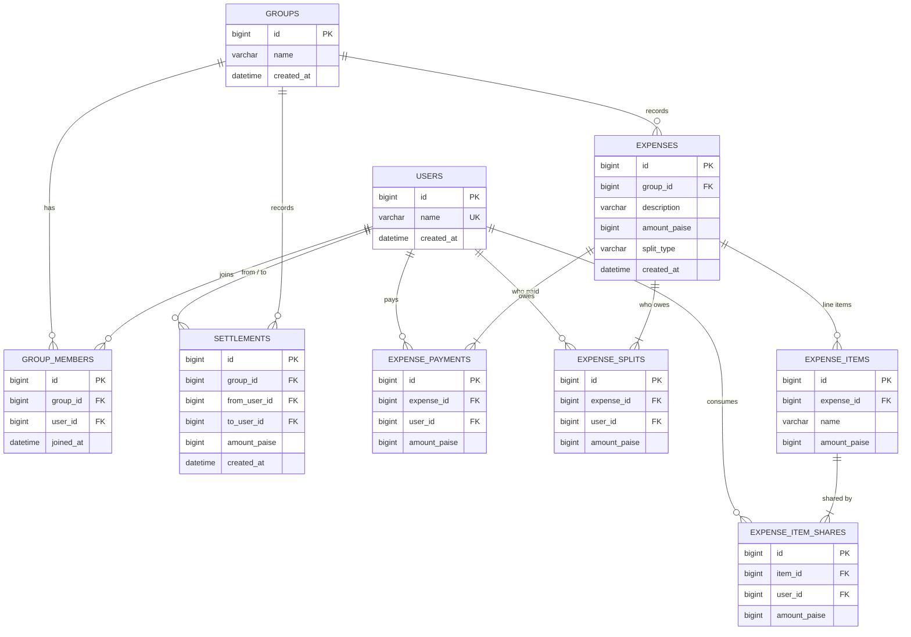

# Database Design

## Summary

An expense has two independent sides: **who paid** (`expense_payments`) and **who consumed** (`expense_splits`). Balances are never stored. They're calculated from these facts plus `settlements`. How an expense was split (equally or by item) only matters when it's saved, because the balance calculation only reads `expense_splits`. All money is stored as integer **paise**.

## Entity-relationship diagram



## Tables

| Table | Purpose | Key rules |
|---|---|---|
| `users` | people who share expenses | name unique, ignoring case (`UNIQUE(lower(name))`) |
| `groups` | a trip, flat, etc. | names may repeat |
| `group_members` | users ↔ groups (many-to-many) | `UNIQUE(group_id, user_id)`; deleting a group removes its memberships |
| `expenses` | one row per bill | `amount_paise > 0`; `split_type IN ('equal', 'itemized')`; a group with expenses can't be deleted |
| `expense_payments` | who paid, and how much | one row per payer; `UNIQUE(expense_id, user_id)`; amount > 0; payers add up to the expense amount |
| `expense_splits` | each person's share of the bill | written for **every** expense; `UNIQUE(expense_id, user_id)`; amount > 0; shares add up to the expense amount |
| `expense_items` | line items of an itemized bill | amount > 0; items add up to the expense amount |
| `expense_item_shares` | who shared each item, and their part | `UNIQUE(item_id, user_id)`; amount > 0 |
| `settlements` | repayments between members | amount > 0; `CHECK(from_user_id <> to_user_id)` |

Deleting an expense removes its payments, splits, items and item shares (CASCADE). A user who appears in any group, payment, split or settlement can't be deleted (PROTECT).

### Who enforces what

| Rule | Database | Serializer (400 with a message) |
|---|---|---|
| amounts > 0 | CHECK | yes |
| no duplicates (members, payers, people in a split) | UNIQUE | yes |
| unique names, ignoring case | functional UNIQUE index | yes |
| no self-settlement | CHECK | yes |
| payers and items add up to the amount | — (spans rows) | yes |
| everyone involved is a group member | — (spans tables) | yes |
| settlement ≤ outstanding balance | — (needs aggregates) | yes, checked in the same transaction as the insert |

Shares always add up exactly because `split_equally` uses integer `divmod`.

## How balances are calculated

Four aggregate queries per group, however many expenses it has:

```sql
SELECT p.user_id, SUM(p.amount_paise) FROM expense_payments p JOIN expenses e ON e.id = p.expense_id
 WHERE e.group_id = :g GROUP BY p.user_id;                                  -- paid
SELECT s.user_id, SUM(s.amount_paise) FROM expense_splits s JOIN expenses e ON e.id = s.expense_id
 WHERE e.group_id = :g GROUP BY s.user_id;                                  -- share
SELECT from_user_id, SUM(amount_paise) FROM settlements WHERE group_id = :g GROUP BY from_user_id;  -- sent
SELECT to_user_id,   SUM(amount_paise) FROM settlements WHERE group_id = :g GROUP BY to_user_id;    -- received
```

```
net = paid − share + settlements sent − settlements received
net > 0: the group owes this person.  net < 0: this person owes.  Nets always add up to 0.
```

"Who owes whom" is calculated from the nets: each debtor pays creditors in turn until everyone is at zero, which takes at most n − 1 payments.

## Three scenarios

Users: 1 Mohit, 2 Rahul, 3 Ankit, all in group 1 "Goa Trip". Amounts are shown in ₹ and stored in paise.

### 1. Equal split, then a settlement (the assignment's example)

Dinner ₹1200, paid by Mohit, split equally. Rahul then pays Mohit ₹400.

| Table | Rows |
|---|---|
| expenses | (Dinner, 120000, equal) |
| expense_payments | Mohit 120000 |
| expense_splits | Mohit 40000 · Rahul 40000 · Ankit 40000 |
| settlements | Rahul → Mohit 40000 |

| Member | net before | net after the settlement |
|---|---|---|
| Mohit | +800 | +400 |
| Rahul | −400 | 0 |
| Ankit | −400 | −400 |

Mohit's own ₹400 share cancels out inside his net, so a payer never owes themselves. Before the settlement, Rahul and Ankit each owe Mohit ₹400 (the expected output). After it, only Ankit does.

### 2. One bill, items shared by different people

Lunch ₹1500 paid by Rahul: Pizza ₹600 (Mohit, Rahul), Beer ₹400 (Ankit), Fries ₹500 (all three).

| Table | Rows |
|---|---|
| expense_items | Pizza 60000 · Beer 40000 · Fries 50000 |
| expense_item_shares | Pizza: Mohit 30000, Rahul 30000 · Beer: Ankit 40000 · Fries: 16667, 16667, 16666 |
| expense_splits (roll-up) | Mohit 46667 · Rahul 46667 · Ankit 56666 (adds up to 150000) |

With an equal split everyone would pay ₹500, so Mohit would pay towards Ankit's beer. The item shares roll up into `expense_splits`, so the balance code is unchanged.

### 3. Two payers, then everything combined

Hotel ₹9000 paid by Mohit ₹6000 and Ankit ₹3000: Room A ₹5000 (Mohit, Rahul), Room B ₹4000 (Ankit).

| Table | Rows |
|---|---|
| expense_payments | Mohit 600000 · Ankit 300000 |
| expense_splits | Mohit 250000 · Rahul 250000 · Ankit 400000 |

All events in order (dinner → Rahul's ₹400 settlement → lunch → hotel):

| Member | paid | share | sent | received | net |
|---|---|---|---|---|---|
| Mohit | 7200.00 | 3366.67 | 0 | 400.00 | +3433.33 |
| Rahul | 1500.00 | 3366.67 | 400.00 | 0 | −1466.67 |
| Ankit | 3000.00 | 4966.66 | 0 | 0 | −1966.66 |

Result: Rahul pays Mohit ₹1466.67 and Ankit pays Mohit ₹1966.66. That's two payments for three expenses and a settlement. A single `paid_by` column couldn't represent this bill, and "pay back the payer" logic would be ambiguous with two payers. Net balances don't need to know which payer a debt belongs to.

All three scenarios are automated tests (`backend/ledger/tests/test_scenarios.py`).

## Alternatives considered

| Alternative | Why not |
|---|---|
| A stored `balances` table updated on every write | can drift out of sync and race under concurrent writes; calculating takes four indexed queries |
| `DECIMAL` money | SQLite has no true decimal type, so sums can turn into floats; integers are exact everywhere |
| A nullable `item_id` on `expense_splits` | mixes two granularities in one table, and NULLs weaken the UNIQUE constraints |
| A single `paid_by` column | can't represent a bill paid by two people |
